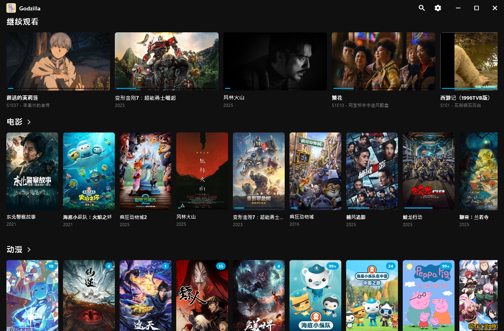
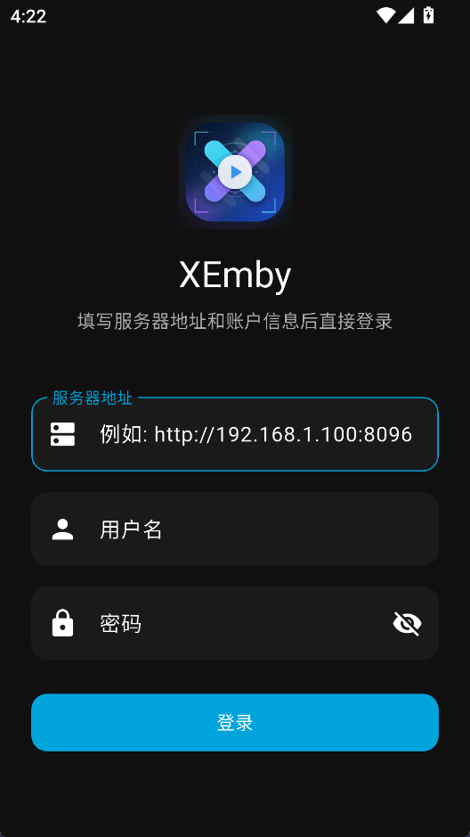
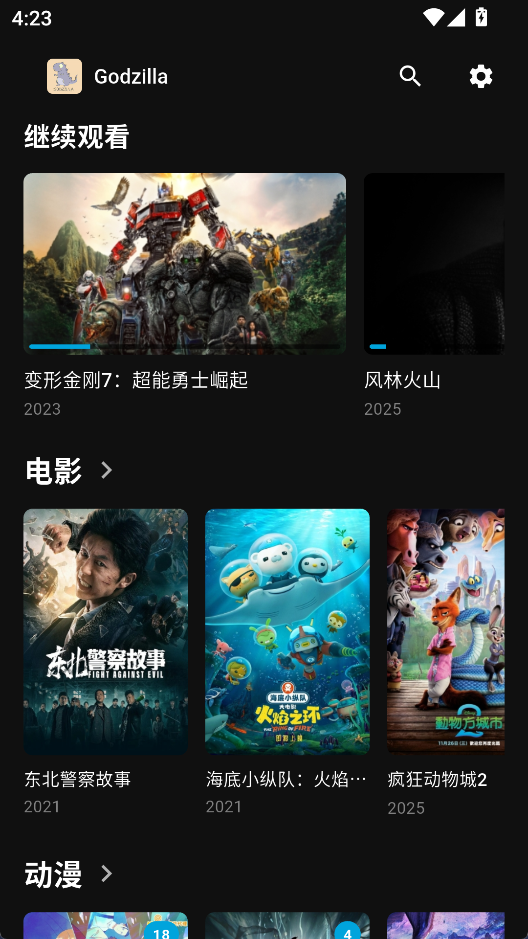
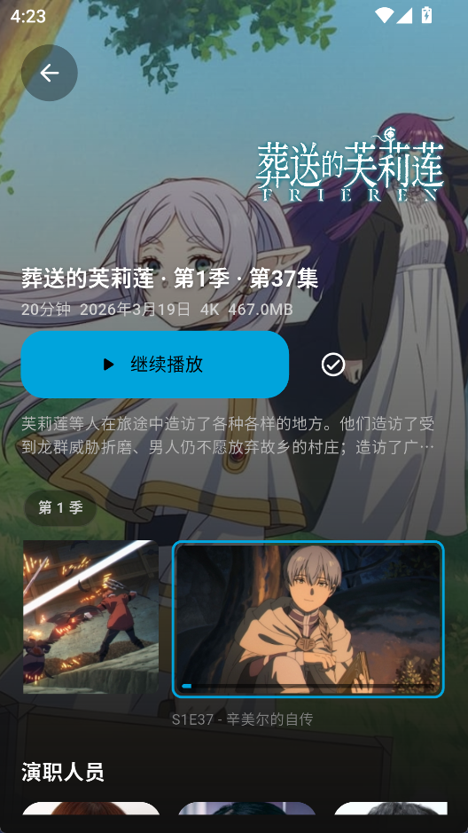
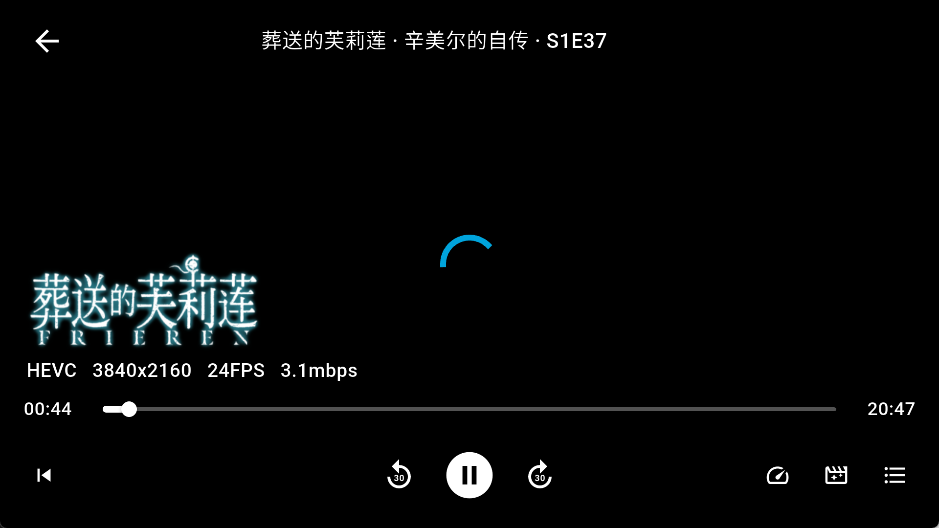
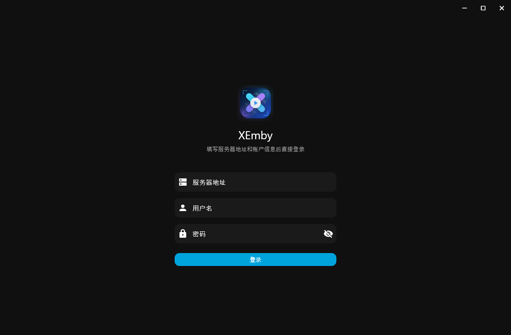
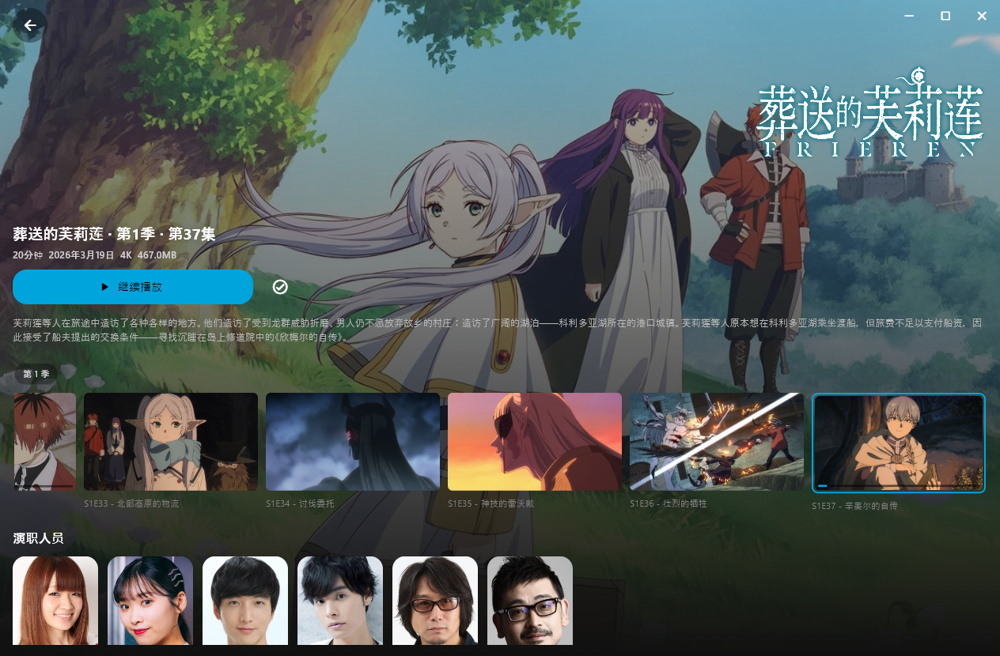
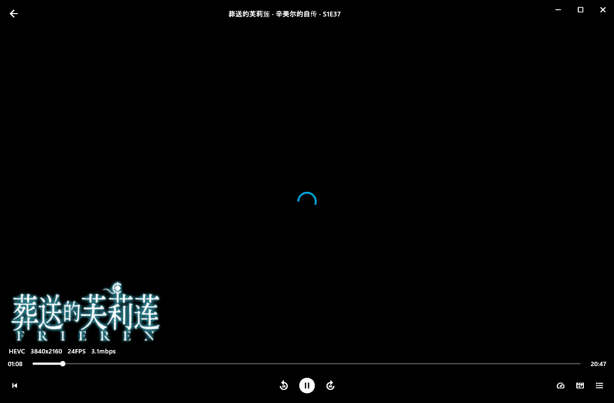

# XEmby

<p align="center">
  
</p>

<p align="center">
  一个围绕 Emby 打造的多平台客户端，覆盖登录、媒体库浏览、详情页和播放器主链路。
</p>

## 项目简介

XEmby 面向 Emby 用户，目标是在不同设备上提供统一、直接、易用的媒体浏览与播放体验。当前展示内容覆盖移动端与 Windows 桌面端界面，整体采用深色视觉风格，突出海报墙、继续观看和播放控制等高频场景。

## 核心体验

- 连接 Emby 服务器并完成账号登录
- 浏览首页内容、继续观看和媒体库条目
- 查看电影、剧集与分集详情
- 从详情页直接进入播放器并继续播放
- 在移动端与 Windows 桌面端保持一致的视觉语言

## 界面预览

### 移动端

<p align="center">
  
  
  
  
</p>

- 登录页支持直接填写 Emby 服务器地址、用户名和密码。
- 首页聚焦继续观看与媒体库浏览，适合触控场景快速进入内容。
- 详情页强调剧集信息、分集切换和继续播放入口。
- 播放器围绕进度控制与沉浸式观看体验进行设计。

### Windows 桌面端

<p align="center">
  
  
</p>

<p align="center">
  
  
</p>

- 桌面端首页突出海报墙和继续观看，适合大屏浏览。
- 详情页提供更宽松的信息布局，便于快速浏览简介、分集和演职员。
- 播放器更强调全屏观影与桌面控制体验。

## 适合的使用场景

- 想在手机或桌面端快速进入 Emby 媒体库
- 需要从“继续观看”无缝回到上次播放位置
- 希望在同一套产品语言下完成浏览、选集和播放

## 目录说明

```text
.
├─ README.md
└─ images/
   ├─ mobile/
   │  ├─ details.png
   │  ├─ home.png
   │  ├─ login.png
   │  └─ player.png
   └─ windows/
      ├─ details.png
      ├─ home.png
      ├─ login.png
      └─ player.png
```

当前目录是 XEmby 的发布展示目录，主要用于介绍产品和存放界面截图素材；完整源码工程不在这个目录中。
