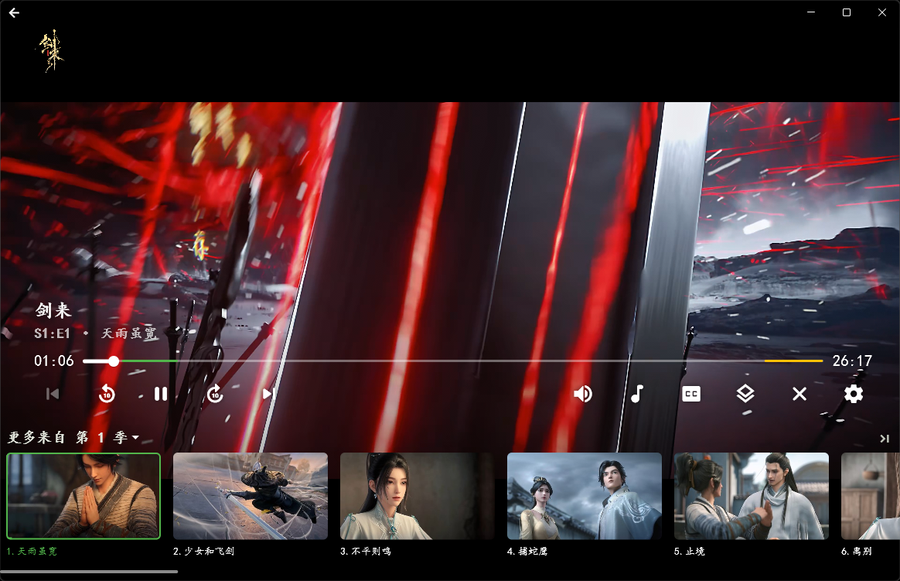
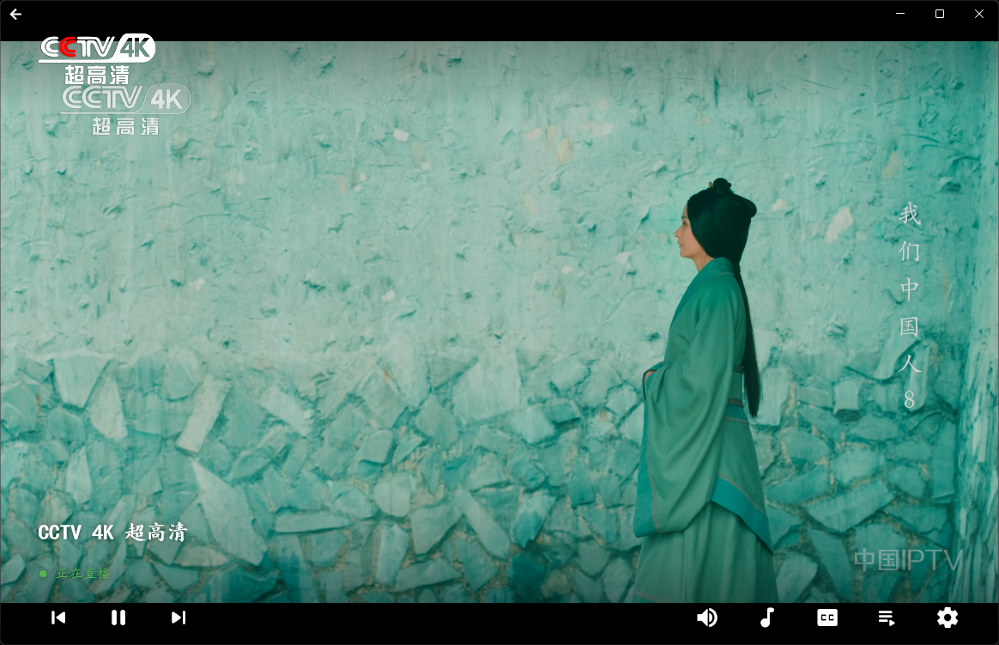

# XEmby

XEmby 是一款面向 **Windows x64** 的 Emby 客户端，支持媒体库浏览、剧集续播和电视直播。播放器基于 libmpv，默认使用 D3D11 硬件解码。

[下载 Windows 版](https://github.com/fxstd/xemby/releases) · [加入 QQ 群](https://qm.qq.com/q/w2e5Q7JnGM)

## 下载安装

1. 在发布页的 **Assets** 中选择 Windows 安装包或 ZIP 压缩包。若下载 ZIP，请完整解压后再启动程序，不要单独复制 EXE。
2. 首次启动时填写 Emby 服务器地址、用户名和密码。服务器地址可以包含子路径，例如 `https://example.com/emby`。
3. 登录后可浏览媒体库；如需观看直播，你的 Emby 服务器须已配置直播源，且账号有直播权限。

如果启动时提示缺少运行库，请安装微软的 [Visual C++ x64 运行库](https://aka.ms/vs/17/release/vc_redist.x64.exe)。XEmby 不内置影视内容或直播源。

> 本页截图及功能以当前 Windows 版为准，较早的发布包可能不包含全部功能。

## 主要功能

- **媒体库与搜索**：通过海报墙浏览电影和剧集，支持全局搜索、排序及查看最新添加内容。
- **续播与选集**：通过「继续观看」回到上次播放位置；支持已看标记、播放中选集和自动连播。
- **点播控制**：优先直播放原始媒体，支持倍速、音轨、字幕和播放版本切换；进度条显示已缓冲范围。
- **在线字幕**：除内嵌字幕和 Emby 外挂字幕外，也可配置 OpenSubtitles 或 ASSRT 账号搜索字幕。
- **片头片尾**：可手动设置跳过区间，或在「播放设置 → 片头片尾」开启 IntroDB 自动识别；进度条会标记对应区间。
- **电视直播**：支持 Emby 提供的 RTSP 和 HTTP 直播流，可搜索频道，或在播放中通过频道列表、上一频道和下一频道换台。

常用快捷键：`空格` 播放或暂停，`←` / `→` 后退或前进 10 秒，`F11` 切换全屏，`Esc` 返回。

## 界面预览

| 媒体库 · 海报墙与排序 | 剧集详情 · 选集与续播 |
| :---: | :---: |
|  |  |
| **点播 · 字幕与进度** | **播放中选集 · 无需返回详情页** |
|  |  |

### 电视直播

## 交流与反馈

QQ 群：`698011070` · [加入群聊【XEmby】](https://qm.qq.com/q/w2e5Q7JnGM)

本仓库用于发布和展示 XEmby，不包含完整源码。
